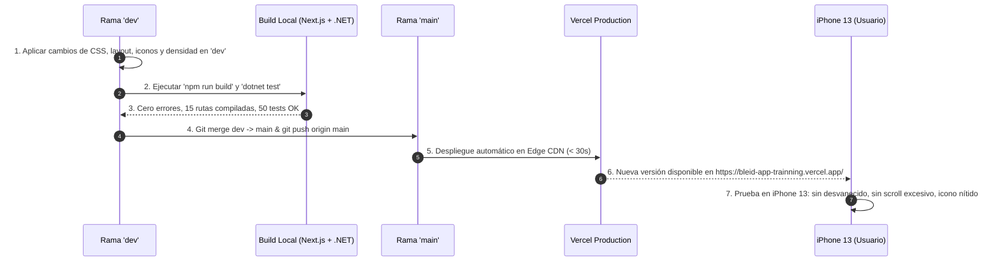

# Plan de Implementación: Optimización Mobile para iPhone 13 y Sección Entrenar

## Objetivo

Optimizar a fondo la experiencia móvil de **Bleid** con foco prioritario en el viewport real de un **iPhone 13 estándar** (`390px × 844px`), eliminando el scroll innecesario en toda la aplicación —**especialmente en la sección Entrenar (`/workout` y `/workout/[sessionId]`)**—, corrigiendo la carga del icono en la pantalla de inicio (PWA) y el efecto de desvanecido superior provocado por el notch/barra de estado, con un flujo de despliegue ordenado y seguro a producción.

---

## Especificaciones del Dispositivo Objetivo (iPhone 13)

| Parámetro | Valor Técnico | Impacto en Diseño |
| :--- | :--- | :--- |
| **Viewport CSS** | `390px` ancho × `844px` alto | Ancho estrecho; cada pixel vertical cuenta |
| **Notch Superior** | `env(safe-area-inset-top) = 47px` | Debe protegerse con `safe-top` para no tapar títulos |
| **Barra Inferior (Home Bar)** | `env(safe-area-inset-bottom) = 34px` | Dock flotante requiere separación justa sin `pb-32` excesivo |
| **Altura Útil en Safari/PWA** | ~`715px` (PWA) / ~`640px` (Safari) | **Objetivo:** Métricas y acción principal visibles sin hacer scroll |

---

## Diagnóstico y Solución por Apartados

```mermaid
flowchart TD
    subgraph A["1. Icono de Inicio (iOS PWA)"]
        A1["icon.svg con rx=116 y esquinas transparentes"] --> A2["iOS genera esquinas negras o screenshot"]
        A2 --> A3["SOLUCIÓN: apple-touch-icon.png 180x180 con fondo sólido #16120E y B atlética centrada"]
    end

    subgraph B["2. Desvanecido Superior en iPhone"]
        B1["statusBarStyle: 'black-translucent'"] --> B2["iOS dibuja máscara negra degradada sobre el notch"]
        B2 --> B3["SOLUCIÓN: statusBarStyle: 'default' + themeColor '#FAF7F2' + safe-top 47px"]
    end

    subgraph C["3. Sección Entrenar (/workout)"]
        C1["Botón 'Empezar sesión' al fondo tras 1.500px de scroll"] --> C2["SOLUCIÓN: CTA 'Empezar sesión' inmediato en el Hero del Día"]
        C3["Editor de rutina ocupa 500px continuos"] --> C4["SOLUCIÓN: Rutina en acordeón colapsable + lista de ejercicios compacta"]
    end

    subgraph D["4. Sesión Activa (/workout/id)"]
        D1["Cards de ejercicios de 280px con inputs gigantes"] --> D2["SOLUCIÓN: High-density cards con inputs compactos de registro rápido"]
    end
```



---

## 1. Iconos de Pantalla de Inicio (PWA) para iPhone 13 y Android

### Causa Raíz
- `public/icon.svg` tiene esquinas redondeadas (`rx="116"`) con fondo transparente en las 4 esquinas. En iOS, al pulsar "Agregar a inicio", el sistema aplica su propio recorte y rellena los píxeles transparentes con negro o muestra una captura de pantalla en miniatura.
- `public/icon-192.svg` y `public/icon-512.svg` tenían formas genéricas desactualizadas.

### Solución
1. Generar via script Node.js:
   - `apple-touch-icon.png` (180x180): Lienzo sólido `#16120E` sin esquinas recortadas, isotipo "B" con proporciones exactas y punto dorado `#D4A359`.
   - `icon-192x192.png` y `icon-512x512.png`: PNGs de alta fidelidad.
   - `icon-maskable-512x512.png`: Fondo con sangrado 100% y arte dentro del círculo safe-zone del 80%.
   - Actualizar los SVGs `icon.svg`, `icon-192.svg` e `icon-512.svg`.
2. Actualizar [layout.tsx](file:///C:/Users/User/Downloads/BleidAppTrainning/bleid-web/app/layout.tsx) con las etiquetas `apple-touch-icon` y `apple-touch-icon-precomposed`.

---

## 2. Eliminación del Desvanecido Superior (Notch iPhone 13)

### Causa Raíz
- `statusBarStyle: "black-translucent"` en [layout.tsx](file:///C:/Users/User/Downloads/BleidAppTrainning/bleid-web/app/layout.tsx): en iOS le indica al navegador que extienda la vista debajo de la barra de estado y proyecte un **degradado negro nativo** para contrastar iconos blancos. Sobre el fondo marfil/crema (`#FAF7F2`), genera una sombra oscura que cubre "Hola, Atleta" y los títulos de todas las pantallas.
- Faltaba el padding compensador del notch de 47px (`env(safe-area-inset-top)`).

### Solución
- Cambiar `statusBarStyle: "default"`: iOS usa iconos oscuros limpios (hora, batería, wifi) sobre el fondo marfil claro sin sombra ni degradado.
- Cambiar `themeColor: "#FAF7F2"`.
- En [app-shell.tsx](file:///C:/Users/User/Downloads/BleidAppTrainning/bleid-web/components/layout/app-shell.tsx):
  ```tsx
  <main className="min-h-screen pt-[max(0.75rem,env(safe-area-inset-top))] pb-20 lg:pt-0 lg:pb-10">
  ```
  Los títulos arrancan limpios debajo del notch de 47px del iPhone 13.

---

## 3. Ultra-Compactación de la Sección "Entrenar" (`/workout`)

> [!IMPORTANT]
> En la versión actual, el botón principal **"Empezar esta sesión"** está al final de la página (línea 320), debajo de toda la lista de ejercicios y del editor completo de rutinas. El usuario de iPhone 13 tiene que hacer scroll de más de 1.500px solo para poder empezar a entrenar.

### Mejoras Específicas en `/workout`:
1. **Acción Principal Inmediata (Above the Fold)**:
   - Mover el botón **"Empezar sesión"** a la tarjeta superior del día seleccionado (`selectedDay`). El usuario abre "Entrenar" y puede arrancar con 1 solo toque en los primeros 300px de pantalla.
2. **Selector de Días Compacto**:
   - Reemplazar las pestañas altas (`h-[68px]` con `p-4`) por pastillas horizontales de alta densidad con scroll táctil (`px-3 py-2`, `text-xs`).
3. **Lista de Ejercicios del Día de Alta Densidad**:
   - Reducir cada fila de ejercicio de ~80px a ~48px (`p-2.5 sm:p-4`), con nombre y series/reps en una sola línea clara.
4. **Editor de Rutinas en Acordeón Colapsable**:
   - Convertir `<RoutineEditor />` en un acordeón plegado por defecto (*"Personalizar ejercicios de este día"*). Quien entra a entrenar no necesita ver 500px de buscador de catálogo a menos que decida editarlo.
5. **Reducción de Márgenes**:
   - Padding de página: `px-4 py-3 sm:px-8 sm:py-6`.
   - Menos espacio muerto: eliminar tarjetas informativas redundantes.

---

## 4. Ultra-Compactación de la Sesión Activa (`/workout/[sessionId]`)

Para registrar series en el gimnasio con una sola mano en un iPhone 13 sin scroll perpetuo:

### Mejoras Específicas en `/workout/[sessionId]`:
1. **Cabecera Compacta en 1 sola fila**:
   - Unificar nombre de la sesión + contador de series + porcentaje en una barra delgada:
     `Día 01 · Torso Pesado [4/16 series - 25%]`
2. **Tarjetas de Ejercicio Ultra-Densas**:
   - Padding reducido: `p-3.5 sm:p-5`.
   - Fila de herramientas integradas: nombre del ejercicio + accesos a 1RM y Calculadora de Discos como botones compactos en línea.
   - Indicador de "Memoria de Carga Anterior" condensado (`Anterior: 60kg × 8`).
3. **Tabla de Series Registradas Compacta**:
   - Cada serie guardada en `py-1` (30px de alto en vez de 50px).
4. **Inputs de Registro Rápido**:
   - Cajas de Kg y Reps con altura `h-10` y botón de check `h-10 w-10` en una cuadrícula compacta y directa.
5. **Botón "Finalizar Sesión" Accesible**:
   - Sección de notas compactada y botón de cierre claro sin requerir scroll infinito.

---

## 5. Compactación del Dashboard (`/dashboard`)

En un iPhone 13 (844px de alto):
1. **Métricas en Cuadrícula 2×2**:
   - `grid-cols-2 gap-2.5 sm:grid-cols-2 lg:grid-cols-4`.
   - Altura de tarjeta: ~85px en mobile (en vez de 125px).
   - Racha, Volumen, Peso y Split visibles juntos en ~180px de alto total (ahorro de más de 300px verticales).
2. **Hero de Sesión del Día Compacto**:
   - `p-4 sm:p-6 lg:p-8`, título `text-2xl sm:text-4xl`, pastillas de ejercicios en 1 línea con `truncate`.
   - Botón "Empezar sesión" a la vista de inmediato.
3. **Márgenes Globales**:
   - `px-4 py-3 sm:px-8 sm:py-6`, navegación inferior con padding de base `pb-20` (en vez de `pb-32`).

---

## 6. Procedimiento Paso a Paso de Verificación y Despliegue



---

## Plan de Pruebas

### Pruebas Automatizadas
1. `cd bleid-web && npm run build` (código de salida 0, 15 rutas).
2. `& "C:\Users\User\AppData\Local\Microsoft\dotnet\dotnet.exe" test bleid-api/BleidAppTraining.sln` (50/50 tests passing).

### Verificación Manual en iPhone 13
1. **Icono**: Añadir a pantalla de inicio desde Safari. El icono debe mostrar fondo oscuro uniforme, bordes redondeados por iOS (sin negro feo ni esquinas cuadradas).
2. **Barra Superior**: Al abrir en pantalla completa (PWA) o Safari, la fecha y los títulos no deben estar cubiertos por ningún degradado negro; el notch no debe cortar las letras.
3. **Entrenar**: Al entrar a `/workout`, el botón para empezar la sesión debe estar visible arriba sin tener que escrollear toda la pantalla.
4. **Dashboard**: Las 4 métricas deben verse juntas en 2 columnas ocupando un bloque compacto.
