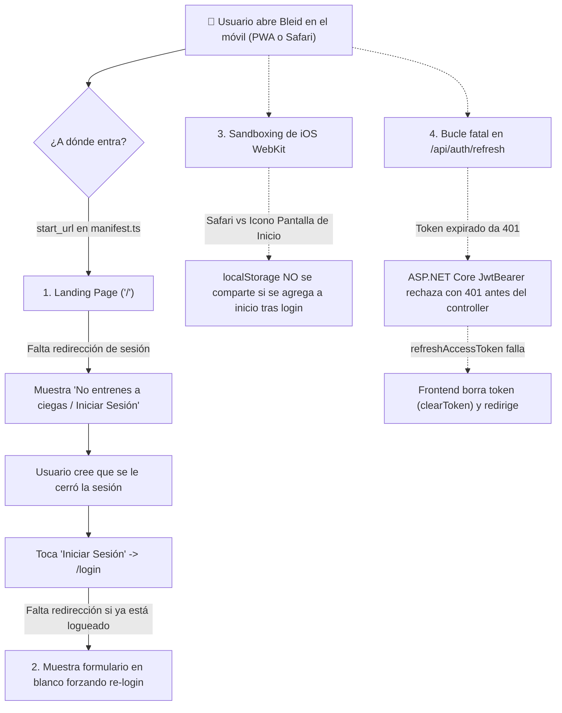
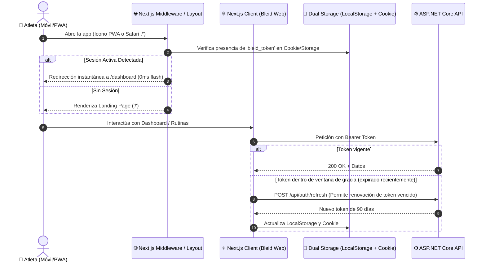

# Plan de Auditoría y Remediación: Persistencia Definitiva de Sesión en Móvil (Bleid App)

> **For agentic workers:** REQUIRED SUB-SKILL: Use superpowers:subagent-driven-development (recommended) or superpowers:executing-plans to implement this plan task-by-task. Steps use checkbox (`- [ ]`) syntax for tracking.

**Goal:** Resolver de raíz y de forma definitiva el problema por el cual la sesión no se mantiene abierta en dispositivos móviles (iPhone / Android / PWA / navegadores móviles), eliminando el bucle de la landing page, sincronizando almacenamiento (localStorage + Cookies persistentes), corrigiendo el mecanismo de refresh de JWT y blindando la tolerancia a fallos en arranques en frío de Render.

---

## 1. Diagnóstico Exhaustivo de la Auditoría (Root Cause Analysis)

Tras auditar en profundidad el flujo completo de autenticación entre Next.js 14 (`bleid-web`), ASP.NET Core (`bleid-api`), la PWA y los navegadores móviles (iOS Safari y Android Chrome), se identificaron **6 causas raíz interconectadas**:



### Causa 1: Bucle de Landing Page (`/`) y `start_url` del PWA Manifest (Problema Principal de UX)
* En `bleid-web/app/manifest.ts`, `start_url` está fijado en `"/"`.
* Cuando el usuario instala la PWA en Android o iOS y la abre desde el icono de su pantalla de inicio, o cuando el sistema operativo móvil mata la app en segundo plano para liberar memoria RAM, **el móvil vuelve a abrir la app en `"/"`**.
* En `bleid-web/app/page.tsx`, la página de inicio es una landing estática de marketing. **No tiene ningún chequeo de sesión**. No redirige a `/dashboard` si el atleta ya está autenticado.
* **Resultado:** El usuario abre la app y lo primero que ve es *"No entrenes a ciegas"*, *"Comenzar"* e *"Iniciar Sesión"*. Cree automáticamente que la app lo deslogueó.

### Causa 2: Trampa de `/login` y `/register` sin redirección de usuario autenticado
* Cuando el usuario ve la landing y toca *"Iniciar Sesión"*, el router lo lleva a `/login`.
* En `bleid-web/app/login/page.tsx`, el componente tampoco evalúa `isAuthenticated()`.
* Aunque el token siga intacto en el almacenamiento local del teléfono, la pantalla le presenta los campos vacíos de email y contraseña. El usuario se ve obligado a tipear sus credenciales de nuevo.

### Causa 3: Bucle Fatal del Refresh Token (Catch-22 Arquitectónico)
* En `bleid-web/lib/api/client.ts`, si una petición recibe un `401`, intenta llamar a `refreshAccessToken()`, enviando el token actual a `POST /api/auth/refresh`.
* En `bleid-api/BleidAppTraining.API/Program.cs`:
  ```csharp
  options.TokenValidationParameters = new TokenValidationParameters {
      ValidateLifetime = true, // <--- Valida expiración
      ...
  };
  ```
* En `AuthController.cs`, el endpoint `[HttpPost("refresh")]` exige autorización Bearer.
* Si el token ya venció, el middleware de ASP.NET Core rechaza la petición con `401 Unauthorized` **antes de que `AuthController.Refresh` pueda ejecutarse**.
* Como la llamada a refresh recibe `401`, `client.ts` concluye que no se pudo renovar, ejecuta `clearToken()` y expulsa al usuario al login.
* Además, en `bleid-web/lib/auth.ts`, `isAuthenticated()` borra el token de forma agresiva en cuanto `Date.now() >= exp * 1000`, imposibilitando cualquier intento de renovación en segundo plano.

### Causa 4: Aislamiento de Almacenamiento en iOS Safari (WebKit Sandboxing)
* En iOS, una PWA agregada a la pantalla de inicio corre en un contenedor WebKit aislado e independiente de Safari.
* Si un usuario inicia sesión en Safari y luego toca *"Agregar a pantalla de inicio"*, el `localStorage` **no se traspasa al icono de la app**. Al abrir la app desde la pantalla de inicio, arranca con un `localStorage` vacío.
* Si no existe persistencia mediante cookies seguras (`document.cookie` / `Set-Cookie` con `SameSite=Lax` y `Secure`), el entorno queda sin sesión.

### Causa 5: Tolerancia a Arranques en Frío de Render (Free Tier)
* La API está alojada en el plan gratuito de Render. Tras 15 minutos sin peticiones, el contenedor entra en hibernación y tarda entre 40 y 60 segundos en despertar.
* Cuando un usuario abre la app en el móvil con red celular, si una petición tarda demasiado o arroja errores de red temporales (502/504 de Render), el frontend debe tolerar el despertar del servidor y reintentar con backoff, en lugar de desloguear al usuario ante fallos de conexión.

---

## 2. Decisiones de Arquitectura y Solución Propuesta



### Decisiones Clave:
1. **Doble persistencia sincronizada (Dual Storage):** El token se guardará en `localStorage` y en una Cookie persistente de 90 días (`bleid_token; max-age=7776000; path=/; SameSite=Lax; Secure`). Esto permite que el Middleware de Next.js redirija al vuelo antes de pintar la pantalla, y que iOS PWA recupere la sesión si Safari ya la tenía.
2. **Next.js Middleware Inteligente:**
   * Si el usuario autenticado entra a `/`, `/login` o `/register`, es redirigido automáticamente a `/dashboard`.
   * Si el usuario sin sesión entra a `/dashboard`, `/workout`, etc., es redirigido a `/login`.
3. **Redirección en Cliente para PWA:** Páginas `/`, `/login` y `/register` incluirán un guard en cliente que, si detecta sesión en `localStorage` o cookie, hace `router.replace('/dashboard')` inmediatamente.
4. **Renovación Silenciosa con Ventana de Gracia en Backend:**
   * Permitir que `/api/auth/refresh` acepte tokens expirados dentro de una ventana de gracia segura (ej. hasta 30 días posteriores a la expiración), validando la firma y la identidad del usuario en base de datos.
   * `isAuthenticated()` en el frontend no destruirá el token inmediatamente al expirar; dejará que el interceptor intente refrescarlo.
5. **Ajuste de PWA Manifest:**
   * `start_url` configurado para garantizar que los accesos directos lleven a la experiencia correcta.

---

## User Review Required

> [!IMPORTANT]
> **Comportamiento al abrir la app:** Con este cambio, si el usuario ya tiene sesión abierta, al abrir la app en el móvil o al tocar el icono de la pantalla de inicio, irá **directo a su Dashboard de entrenamiento** (sin ver la landing comercial ni tener que tocar "Iniciar Sesión").
> Si desea cerrar la sesión, podrá hacerlo en cualquier momento desde su pestaña de **Perfil -> Cerrar Sesión**.

> [!TIP]
> **Compatibilidad iPhone / Android:** Al sincronizar el token en cookies y en localStorage, resolvemos tanto el comportamiento en navegadores móviles estándar como en el modo PWA (standalone) de iOS y Android.

---

## Proposed Changes

### Componente 1: Dual Storage y Autenticación en Frontend (`bleid-web`)

#### [MODIFY] `bleid-web/lib/auth.ts`
* Sincronizar lectura y escritura entre `localStorage` y cookies (`bleid_token`).
* Si `localStorage` está vacío pero la cookie existe (caso iOS PWA sandboxed), restaurar automáticamente en `localStorage`.
* Modificar `isAuthenticated()` para que no destruya el token de inmediato si expiró recientemente, permitiendo que `apiFetch` dispare la renovación silenciosa.
* Agregar función utilitaria de cookies compatible con cliente y servidor.

#### [MODIFY] `bleid-web/lib/api/client.ts`
* Mejorar `refreshAccessToken()` para manejar el refresco proactivo.
* Proteger contra falsos deslogueos: solo limpiar token ante un `401` genuino confirmado post-intento de refresco, nunca ante errores de red o timeouts por arranque en frío de Render.
* Agregar timeout controlado (45s) y mensaje de reintento amigable si el backend de Render está despertando.

---

### Componente 2: Ruteo, Redirecciones y PWA (`bleid-web`)

#### [NEW] `bleid-web/middleware.ts`
* Crear Middleware de Next.js que inspeccione la cookie `bleid_token`:
  * Rutas públicas (`/`, `/login`, `/register`): si hay cookie de sesión válida, redirigir directo a `/dashboard`.
  * Rutas protegidas (`/dashboard`, `/workout`, `/exercises`, `/progress`, `/history`, `/profile`, `/onboarding`): si no hay cookie ni token, redirigir a `/login`.

#### [MODIFY] `bleid-web/app/page.tsx`
* Agregar verificación en cliente en caso de que el usuario haya iniciado sesión recientemente en `localStorage` pero la cookie no haya sido procesada en el primer render. Redirigir a `/dashboard` con `router.replace`.

#### [MODIFY] `bleid-web/app/login/page.tsx`
* Agregar chequeo inicial: si `isAuthenticated()`, redirigir inmediatamente a `/dashboard`.

#### [MODIFY] `bleid-web/app/register/page.tsx`
* Agregar chequeo inicial: si `isAuthenticated()`, redirigir inmediatamente a `/dashboard`.

#### [MODIFY] `bleid-web/app/manifest.ts`
* Optimizar `start_url` y configuraciones para asegurar que los accesos directos lleven a la experiencia correcta.

---

### Componente 3: Backend Token Refresh con Ventana de Gracia (`bleid-api`)

#### [MODIFY] `bleid-api/BleidAppTraining.API/Program.cs`
* Configurar esquema o política especial para `/api/auth/refresh` que permita validar tokens cuya firma sea legítima incluso si `ValidateLifetime` ha vencido recientemente (ventana de gracia), permitiendo revivir sesiones móviles de forma segura.

#### [MODIFY] `bleid-api/BleidAppTraining.API/Controllers/AuthController.cs`
* Permitir en `POST /api/auth/refresh` la extracción del `userId` a partir del token provisto en el header `Authorization` aun si está expirado (pero válidamente firmado con el `Jwt:Secret`).

#### [MODIFY] `bleid-api/BleidAppTraining.Infrastructure/Identity/JwtTokenService.cs`
* Agregar método `GetPrincipalFromExpiredToken(string token)` que valide firma, emisor y audiencia sin validar la fecha de expiración, garantizando que solo tokens válidos generados por Bleid puedan renovarse.

---

## Verification Plan

### Automated Tests
1. **Pruebas de Backend (.NET API):**
   * Ejecutar la suite de tests unitarios:
     ```powershell
     dotnet test bleid-api/BleidAppTraining.sln
     ```
   * Agregar pruebas para validación de renovación con token expirado y firma válida.

2. **Build y Linter de Frontend:**
   * Validar compilación de Next.js:
     ```powershell
     cd bleid-web ; npm run build
     ```

### Manual Verification
1. **Prueba de Redirección Automática:**
   * Iniciar sesión en `/login`.
   * Navegar manualmente a `http://localhost:3000/` o cerrar y volver a abrir la pestaña.
   * **Resultado esperado:** La app redirige inmediatamente a `/dashboard` sin mostrar la landing page.
2. **Prueba de `/login` con sesión activa:**
   * Intentar ingresar a `/login` estando autenticado.
   * **Resultado esperado:** Redirección automática a `/dashboard`.
3. **Prueba de PWA Móvil:**
   * Instalar la PWA o abrir en simulador móvil.
   * Cerrar la app completamente y volver a abrirla desde el icono del launcher/pantalla de inicio.
   * **Resultado esperado:** Se abre directamente en `/dashboard` con los datos del usuario cargados.
4. **Prueba de Renovación de Sesión:**
   * Verificar que al llamar a `/api/auth/refresh` con un token vencido pero legítimo, el backend entrega un token nuevo de 90 días y el frontend lo persiste.
